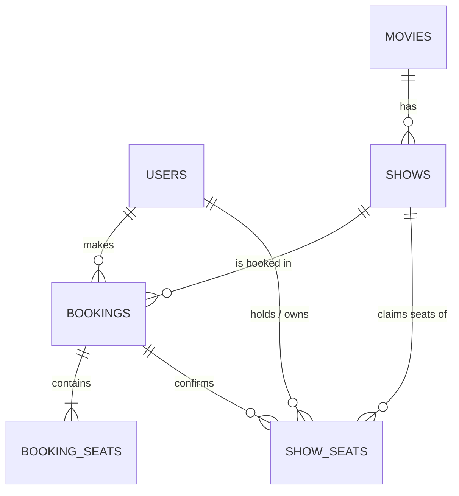

# Cineva: Movie Ticket Booking App

A small-cinema booking site: customers pick a show, choose seats on an 8 × 10 seat map, hold them for 5 minutes, pay (fake payment) and get a booking. **A seat can never be booked twice**, even if two people click at the same instant. This is enforced by the database, not the frontend.

> Payment is a demo only. No real money is collected.

## Flows status

| # | Flow | Status |
| --- | --- | --- |
| 1 | Sign up / log in / log out, protected pages **and** protected API | Done |
| 2 | Browse movies, movie details, upcoming shows grouped by date, seats left | Done |
| 3 | Seat map 8 × 10 with "Screen this way" and available / held / booked states | Done |
| 4 | Select 1–6 seats, total price, 5-minute hold with countdown | Done |
| 5 | Fake payment (success / failure), booking confirmation, no double booking + test | Done |
| 6 | My bookings (upcoming first, then past), private per user | Done |
| 7 | Admin: add / edit / delete movies, add shows, no overlaps, cannot delete show with bookings | Done |
| 8 | Bonus: cancel a booking up to 2 h before the show | Done |
| 9 | Bonus: admin occupancy (x / 80, % full, money collected), booking list, read-only seat map | Done |
| 10 | Bonus: live seat updates | Done (polling every 3 s) |

**Not done / known limitations:** no rate limiting on login; JWT is kept in `localStorage` (simple, but exposed to XSS, so a production app would use an httpOnly cookie); `docker-compose.yml` only starts PostgreSQL (the app itself is run with npm); the admin cannot *edit* a show (add and delete only, which is what the task asks for).

## Test accounts (created by the seed script)

| Role | Email | Password |
| --- | --- | --- |
| Customer | `demo@cineva.com` | `Demo@1234` |
| Admin | `admin@cineva.com` | `Admin@1234` |

Normal sign-up can only ever create customers. The role is never read from the request. Admins exist only through `npm run db:seed`.

## Run it locally

**Requirements:** Node.js 20+ and PostgreSQL 13+ (or Docker).

```bash
# 1. PostgreSQL. Either use Docker (creates the "cineva" and "cineva_test" databases):
docker compose up -d db
#    ...or use your own Postgres and create two empty databases:  createdb cineva && createdb cineva_test

# 2. Configure the server
cp server/.env.example server/.env
#    edit server/.env: DATABASE_URL (as is for Docker) and JWT_SECRET  ->  openssl rand -hex 32

# 3. Install, create tables, load movies + two weeks of shows + the two accounts
npm run install:all
npm run db:setup

# 4. Start API (http://localhost:4000) and web app (http://localhost:5173)
npm run dev
```

Health check: <http://localhost:4000/api/health> should show `"database":"connected"`.

Optional client setting (`client/.env`): `VITE_API_URL` (default `http://localhost:4000/api`).

### Tests

```bash
npm test          # uses TEST_DATABASE_URL (database name must contain "test"); it is wiped on every run
```

25 backend tests run against a **real PostgreSQL** (not a mock), because the thing being proven is database behaviour. The important ones:

* two users hold the same seat at the same moment → exactly one succeeds
* 10 users fight for one seat → exactly one wins
* overlapping multi-seat requests in opposite order → one wins, no deadlock, no half-hold
* both users try to pay for the same seat → only one booking exists
* a raw `INSERT` that bypasses the API is still rejected by the database
* hold expiry, payment failure keeps the hold, paying after expiry is rejected
* auth, privacy (another user's booking → 404), admin-only APIs, show overlap, cancellation rules

## How double booking is prevented

Table `show_seats` has **`PRIMARY KEY (show_id, seat_label)`**. A row exists only while a seat is held or booked, so the database physically cannot contain two claims on one seat.

Holding seats is one atomic statement per seat:

```sql
INSERT INTO show_seats (show_id, seat_label, status, user_id, hold_expires_at) VALUES (...)
ON CONFLICT (show_id, seat_label) DO UPDATE SET user_id = ..., hold_expires_at = ...
WHERE show_seats.status = 'HELD' AND (show_seats.user_id = <me> OR show_seats.hold_expires_at <= NOW())
RETURNING seat_label;
```

If two requests insert the same free seat together, PostgreSQL makes the second wait for the first, then evaluates the `WHERE`: the seat is now actively held by someone else, so nothing is returned and the second request gets a 409 naming the seat. All seats of a hold are done in one transaction (sorted order, so no deadlocks): if any seat fails, everything rolls back. Paying locks the user's held rows (`SELECT … FOR UPDATE`), checks the hold has not expired, creates the booking and flips the rows to `BOOKED`. An expired hold is simply ignored by every query and can be taken over by anyone, so nothing needs a background job to be correct (a 30-second cleanup only keeps the table small).

## Main decisions

* **Node + Express + `pg` (raw SQL), PostgreSQL.** The booking logic is about locks and constraints, and raw SQL keeps that visible and explainable. An ORM would hide exactly the part that matters.
* **Seat claims live in their own table with a composite primary key** instead of "a list of seats on a booking". Uniqueness is then a database guarantee. `booking_seats` is only the permanent history of a booking (kept after cancellation).
* **Hold = a `HELD` row with an expiry**, using the database clock (`NOW()`) as the single source of time. The client only receives "seconds left", so a wrong laptop clock cannot extend a hold.
* **No overlapping shows via an `EXCLUDE USING gist` constraint** on `(screen, time range)`. The API turns the violation into a friendly 409; even a manual SQL insert cannot overlap.
* **JWT (7 days) + bcrypt (12 rounds).** On every request the user is re-loaded from the database, so roles are always current and deleted users lose access. Login returns the same error for a wrong email or a wrong password.
* **Live updates by polling (every 3 s) instead of WebSockets/SSE.** One cinema screen means tiny traffic; polling is stateless, works behind any proxy or free host, needs no connection management, and the seat map endpoint already exists. The cost is up to 3 s of delay and some extra requests. If traffic grew, SSE would be the next step.
* **React + TypeScript + React Router.** Real URLs (`/shows/12/seats`) so refreshing a page shows the latest server state. The UI keeps the original dark/lime Cineva design.

## Database design



| Table | Columns | Notes |
| --- | --- | --- |
| `users` | `id` PK, `name`, `email` UNIQUE, `password_hash`, `role` (`customer`/`admin`), `created_at` | bcrypt hash only |
| `movies` | `id` PK, `title`, `genre`, `duration` (min), `rating` (audience score), `language`, `certificate` (`U`/`UA`/`A`), `description`, `poster` (URL) | `certificate` is the U / UA / A rating |
| `shows` | `id` PK, `movie_id` FK→movies (cascade), `screen`, `starts_at`, `ends_at` (= start + duration), `price` | `EXCLUDE USING gist (screen =, tstzrange(starts_at, ends_at) &&)` blocks overlaps |
| `bookings` | `id` PK, `user_id` FK→users, `show_id` FK→shows, `total_amount`, `status` (`CONFIRMED`/`CANCELLED`), `created_at` | |
| `booking_seats` | `booking_id` FK→bookings, `seat_label` · PK(`booking_id`,`seat_label`) | permanent record of the seats |
| `show_seats` | `show_id` FK→shows, `seat_label` (`A1`–`H10`, CHECK), `status` (`HELD`/`BOOKED`), `user_id` FK→users, `booking_id` FK→bookings, `hold_expires_at` · **PK(`show_id`,`seat_label`)** | the anti-double-booking table |

Full SQL: `server/db/schema.sql`.

## API

| Method | Route | Who | Purpose |
| --- | --- | --- | --- |
| POST | `/api/auth/register`, `/api/auth/login` | public | create account / sign in |
| GET | `/api/auth/me` | login | current user |
| GET | `/api/movies`, `/api/movies/:id` | public | movies; one movie with its upcoming shows |
| GET | `/api/shows?movieId=`, `/api/shows/:id` | public | upcoming shows with seats available |
| GET | `/api/shows/:id/seats` | login | seat map (available / held / booked) + my hold |
| POST / DELETE | `/api/shows/:id/hold` | login | hold up to 6 seats for 5 min / release |
| POST | `/api/shows/:id/pay` | login | `{result:"success"\|"failure"}` fake payment |
| GET | `/api/bookings/me`, `/api/bookings/:id` | login | my bookings (own only) |
| POST | `/api/bookings/:id/cancel` | login | cancel up to 2 h before the show |
| POST / PUT / DELETE | `/api/admin/movies[/:id]` | admin | manage movies |
| GET / POST / DELETE | `/api/admin/shows[/:id]` | admin | list with stats / add / delete shows |
| GET | `/api/admin/shows/:id/bookings` | admin | bookings of a show |

## Assumptions

* One cinema, one screen ("Cineva Cinema · Screen 1"); 80 seats per show (A–H × 1–10).
* Ticket price × seats is the total. The earlier demo's ₹25 convenience fee was removed so the amount matches "price × seats" exactly.
* Booking IDs are shown as `CV-000123` (the numeric database ID padded).
* A show that only has *cancelled* bookings still cannot be deleted (the booking rows reference it).
* Seed times use the cinema's timezone (`SEED_TIMEZONE`, default `Asia/Kolkata`); the browser shows times in the viewer's timezone.

## Project structure

```
client/src   React + TypeScript (pages/, admin/, auth.tsx, ui.tsx, api.ts)
server/src   Express API (app.js, routes/*, middleware.js, lib.js)
server/db    schema.sql, movies.json (seed data)
server/scripts  migrate.js, seed.js
server/test  backend tests (real PostgreSQL)
```
