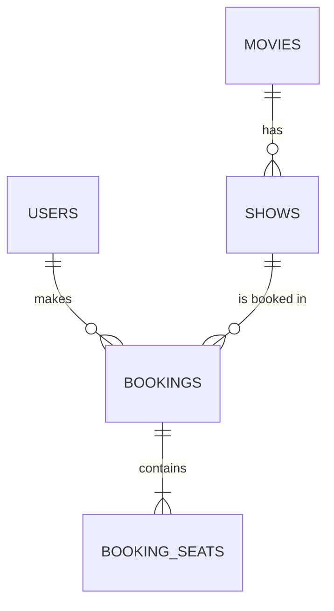

# Cineva — Movie Ticket Booking App

Cineva is a full-stack movie ticket booking app. Users can browse and search movies, filter by genre, pick a show and seats, and confirm a booking. Accounts and bookings are stored in a PostgreSQL database.

> Payment is a demo only. No real money is collected.

## Features

- Browse 49 movies with posters, rating, duration, certificate and language
- Search by title, genre or language (multi-word, e.g. `romance hindi`) and filter by genre
- Sign up and sign in (passwords hashed with bcrypt, JWT session)
- Choose a date, a cinema show and up to 8 seats on a seat map
- Booking is saved in the database; the server rejects seats that were just booked by someone else
- "My bookings" page with ticket details
- Poster fallback: if a poster image fails to load, it is fetched from Wikipedia, and if that fails a title card is shown

## Tech stack

| Part | Technology |
| --- | --- |
| Frontend | React 18, TypeScript, Vite, lucide-react icons, plain CSS |
| Backend | Node.js, Express (REST API), `pg`, `bcryptjs`, `jsonwebtoken`, `dotenv`, `cors` |
| Database | PostgreSQL (SQL) |

## Project structure

```
cineva/
├── client/            React + Vite frontend
│   └── src/App.tsx    All screens and logic
├── server/            Express API
│   ├── src/index.js   Routes, auth, booking transaction
│   └── db/
│       ├── schema.sql Tables, keys, indexes
│       └── seed.sql   Movies, shows and a test user
└── package.json       Root scripts (runs client and server together)
```

## How to run

**Requirements:** Node.js 20+ and PostgreSQL 14+.

### 1. Install PostgreSQL (macOS)

```bash
brew install postgresql@16
brew services start postgresql@16
```

### 2. Create the database and load the data

Run these from the project root:

```bash
createdb cineva
psql cineva -f server/db/schema.sql
psql cineva -f server/db/seed.sql
```

### 3. Create `server/.env`

```bash
cp server/.env.example server/.env
```

Then open `server/.env` and set your values:

| Variable | Meaning | Example |
| --- | --- | --- |
| `PORT` | API port | `4000` |
| `DATABASE_URL` | PostgreSQL connection string | `postgresql://yourname@localhost:5432/cineva` |
| `JWT_SECRET` | Secret used to sign login tokens. Use a long random value: `openssl rand -hex 32` | `3f9a...` |
| `CLIENT_ORIGIN` | Frontend URL allowed by CORS (localhost ports 5173–5175 are always allowed) | `http://localhost:5173` |

Optional, for the client (`client/.env`): `VITE_API_URL` (default `http://localhost:4000/api`).

### 4. Install and start

```bash
npm run install:all
npm run dev
```

- Frontend: http://localhost:5173
- API health check: http://localhost:4000/api/health (should show `"database":"configured"`)

If the health check shows `"database":"demo-mode"`, the server did not find `server/.env`. Check the file location and restart.

## Test login

| Email | Password |
| --- | --- |
| `demo@cineva.com` | `Demo@1234` |

This user is created by `seed.sql`. You can also create your own account with Sign up (password must be at least 8 characters).

## API endpoints

| Method | Route | Auth | Purpose |
| --- | --- | --- | --- |
| GET | `/api/health` | No | Server and database status |
| GET | `/api/movies` | No | List movies |
| GET | `/api/movies/:id` | No | One movie |
| GET | `/api/shows?movieId=` | No | Shows of a movie |
| POST | `/api/auth/register` | No | Create account, returns token |
| POST | `/api/auth/login` | No | Sign in, returns token |
| POST | `/api/bookings` | Yes | Book seats for a show |
| GET | `/api/bookings/me` | Yes | Bookings of the logged-in user |

## Database design

SQL database: **PostgreSQL**. Schema file: `server/db/schema.sql`.



### `users`
| Column | Type | Notes |
| --- | --- | --- |
| `id` | BIGSERIAL | **Primary key** |
| `name` | VARCHAR(100) | Required |
| `email` | VARCHAR(255) | Required, **unique** |
| `password_hash` | TEXT | bcrypt hash, never the plain password |
| `created_at` | TIMESTAMPTZ | Default `NOW()` |

### `movies`
| Column | Type | Notes |
| --- | --- | --- |
| `id` | BIGSERIAL | **Primary key** |
| `title` | VARCHAR(180) | Required |
| `genre` | VARCHAR(120) | Required, e.g. `Romance / Comedy` |
| `duration` | SMALLINT | Minutes, must be > 0 |
| `rating` | NUMERIC(2,1) | |
| `language` | VARCHAR(60) | Required |
| `certificate` | VARCHAR(12) | U, UA, A, etc. |
| `description` | TEXT | Required |
| `poster` | TEXT | Poster image URL |

### `shows`
| Column | Type | Notes |
| --- | --- | --- |
| `id` | BIGSERIAL | **Primary key** |
| `movie_id` | BIGINT | **Foreign key** → `movies(id)`, `ON DELETE CASCADE` |
|
